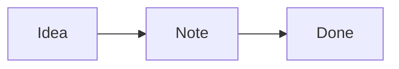

Your notes are plain **Markdown files** in a folder on your Mac. Folders are notebooks (they can be nested), and tags, status and pins live at the top of each file.

## Get around

- **⌘K** command palette: jump to any note or run any command
- **⌘N** new note · **⇧⌘N** new notebook · **⇧⌘F** search
- **⌘1 / ⌘2 / ⌘3** editor · split · preview · **⇧⌘↵** focus mode
- Right-click notes, notebooks and the Trash for more options
- Drag the borders between the sidebar, note list, editor, preview and side panels to resize them (double-click a border to reset)

## Organise

- Add tags and a status in the bar above the editor
- Pin important notes with **⌥⌘P**
- The ⇅ button above the note list sorts the list and **groups** it by notebook (big headings for notebooks, smaller ones for notebooks inside them), by tag, or by type. Click a heading to fold it, **⌥-click** to fold it with everything inside, or right-click it (or use ⇅) for **Expand All / Collapse All**.
- Each note is marked by type: **Note** (red), **Confluence** (blue) or **API** (green)
- Search with filters: `tag:guide`, `book:Ideas`, `status:active`, `title:welcome`, `is:pinned`, `-tag:old`
- The title lives in the big field above the editor; it's also the file name
- Link notes with double brackets, like [[Welcome to VibeNote]] — also Confluence pages and API specs. Add `#` to go deeper: `[[Some note#A heading]]` or `[[My API#GET /users/{id}]]` (type `[[`, then `#`, to pick from a list)
- A note shows **🔗 Linked from** when other notes link to it. Links to Confluence pages you've fetched open your local copy (⌘-click for the browser)

## Confluence

- Click **+** next to **Confluence** in the sidebar, paste a page link, tick the pages you want and **Fetch**. Sub-pages become notebooks.
- Edit the note, then click **Push** to send your changes back. Only the parts you changed are updated; diagrams, macros and images (the 🔒 boxes) stay as they are.
- If someone changed the page in Confluence meanwhile, Push stops. Use **Pull Latest from Confluence** (⌘K) to refresh.
- **Changes to push:** pages you edited but haven't pushed get an orange **edited** label, and **Changes to push** appears in the sidebar's Confluence section. It lists them all with **Show changes**, **Push** (one page) and **Push all** — a page someone else changed meanwhile is skipped, never overwritten.
- **Publish a note as a new page:** on any normal note, click **Push** and choose where it goes (one of your fetched pages or folders, or paste a page link) — or drag the note onto a page or folder in the **Confluence** section of the sidebar. After **Publish** the note moves into your Confluence notebooks and stays linked; Push then updates it.
- **Pictures** (images and draw.io diagrams): click **Show pictures from Confluence** in a 🔒 box, or ⌘K → *Get Pictures from Confluence*. The first time, Atlassian asks you to sign in once more (click Accept). After that, pictures update by themselves when you fetch or pull. Click a picture to open it full size.

## Ask Claude to write

- **Inline suggestions:** pause at the end of a line and Claude suggests how to continue, in grey. **Tab** accepts, **Esc** dismisses, or just keep typing. Turn it off or pick its model in Settings → Claude.

- Type **/claude** on a new line (or press **⇧⌘J**) and ask for something: a table, a checklist, a summary, a diagram… Claude's Markdown appears as it's written; click **Insert** to add it.
- Select text first and press **⇧⌘J** to have Claude rewrite it (**Replace**). Type a new request in the box to adjust the result.
- /claude and @Claude comments also know what you discussed in the **Claude panel** for that project (decisions, names, preferences). The box shows “+ your Claude chat (N messages)” — click it to turn that off.

## API specs (Swagger / OpenAPI)

- **⌥⌘N** (or **+** next to **APIs** in the sidebar) creates an API spec: a pure `.yaml` page, marked **API** in the list.
- Switch the docs between **Swagger** and **Reference** (a modern three-column look with code samples in many languages) with the toggle at the top right. Both can send real requests. Edit the YAML on the left; the Swagger docs update on the right. Mistakes show as “Line N: …” — click to jump there.
- **Try it out → Execute** calls the real API from VibeNote (no browser CORS errors). Tokens entered under **Authorize** are forgotten when VibeNote closes.
- A ` ```yaml ` OpenAPI block inside any note (e.g. a Confluence page) gets an **⚡ API docs** button in the preview — and **Save as API spec** turns it into its own spec page.
- **/claude** works in specs too: “add a POST /bookings endpoint with a 409 conflict response”.

## Comments

- Select text and click **💬** (or **⌥⌘M**) to comment on it; **⇧⌘M** shows all comments.
- Type **@Claude** in a comment (or click **Ask Claude**) and Claude replies in the thread. If it suggests a change, you see before → after and choose **Accept** or **Reject**.
- On Confluence pages, **Post to Confluence** puts a comment on the page for your team. Comments otherwise stay private, in a hidden `.comments` folder next to your notes.

## History

- **⌥⌘Y** opens Version History: every version shows **who** made it (You, Claude, Confluence) and **Changes** shows exactly what was added (green) and removed (red).
- Claude can read the history too — ask it in the Claude panel "what changed in this note today?".

## Watching Claude work

- The Claude panel shows what Claude is doing, like Claude Code in Terminal: its **thinking** (live, then folded into "✻ Thought for 5s"), each **step** as it starts (with a short result such as "→ 120 lines" or "→ +3 −1"), to-do lists, helper agents' progress, and a status line with time and tokens.
- Click a step to see the details — edits show as a red/green diff.
- Press **Esc** in the Claude panel to stop Claude while it works.
- Type **/** in the Claude panel for commands: **/model** (switch model — or click the model button at the top), **/effort**, **/usage** (plan limits and what the chat cost), **/context**, **/clear**, **/chats**, **/mcp**, **/help** — plus all your Claude Code commands and skills (/compact, /init, /code-review…).

## Your past Claude chats

- Open **Claude Chats** (the 🕘 button in the Claude panel, or ⌘K → *Claude Chats*) to see every Claude Code chat you've had in a project folder — from Terminal, VS Code, VibeNote or **T3 Code** (including its helper threads) — and read them as clean conversations.
- **Continue in Claude panel** picks up where a chat left off; Claude remembers everything. Your new messages go to a copy, so the original chat stays as it was.
- T3 Code threads that have no Claude Code chat behind them (helpers, Codex) start a new chat instead, with the old thread given to Claude as background.
- **Save as note** keeps the conversation as a Markdown note (saving again updates it).

## Write

- [x] Paste or drag images straight into a note
- [ ] Click this checkbox in the preview

Math: $E = mc^2$



## Learn more

- The **VibeNote Guide** project (in the sidebar, or **Help → VibeNote Guide**) explains every feature, one short note per area, with all the keyboard shortcuts.
