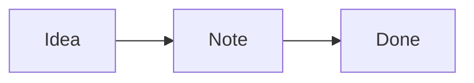

# Welcome to VibeNote

Your notes are plain **Markdown files** in a folder on your Mac. Folders are notebooks (they can be nested), and tags, status and pins live at the top of each file.

## Get around

- **⌘K** command palette: jump to any note or run any command
- **⌘N** new note · **⇧⌘N** new notebook · **⇧⌘F** search
- **⌘1 / ⌘2 / ⌘3** editor · split · preview · **⇧⌘↵** focus mode
- Right-click notes, notebooks and the Trash for more options

## Organise

- Add tags and a status in the bar above the editor
- Pin important notes with **⌥⌘P**
- Search with filters: `tag:guide`, `book:Ideas`, `status:active`, `title:welcome`, `is:pinned`, `-tag:old`
- Link notes with double brackets, like [[Welcome to VibeNote]]

## Write

- [x] Paste or drag images straight into a note
- [ ] Click this checkbox in the preview

Math: $E = mc^2$

